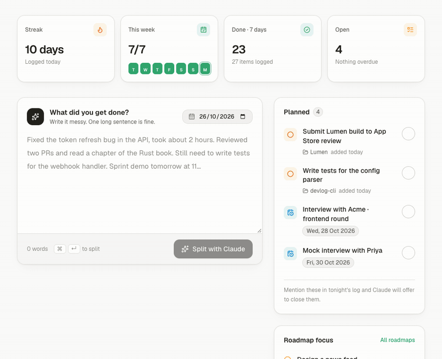
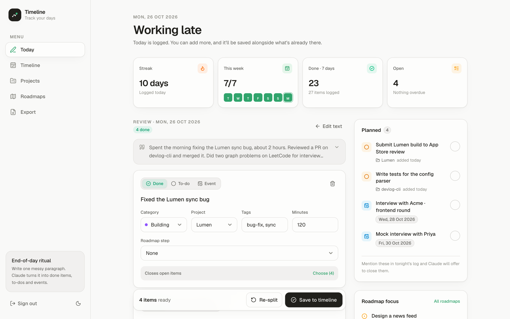
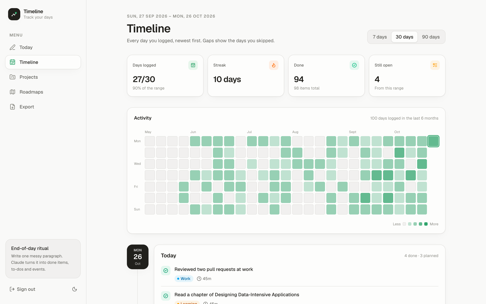
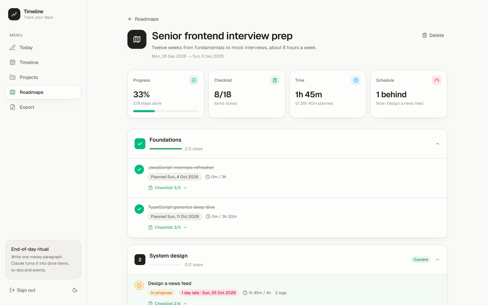
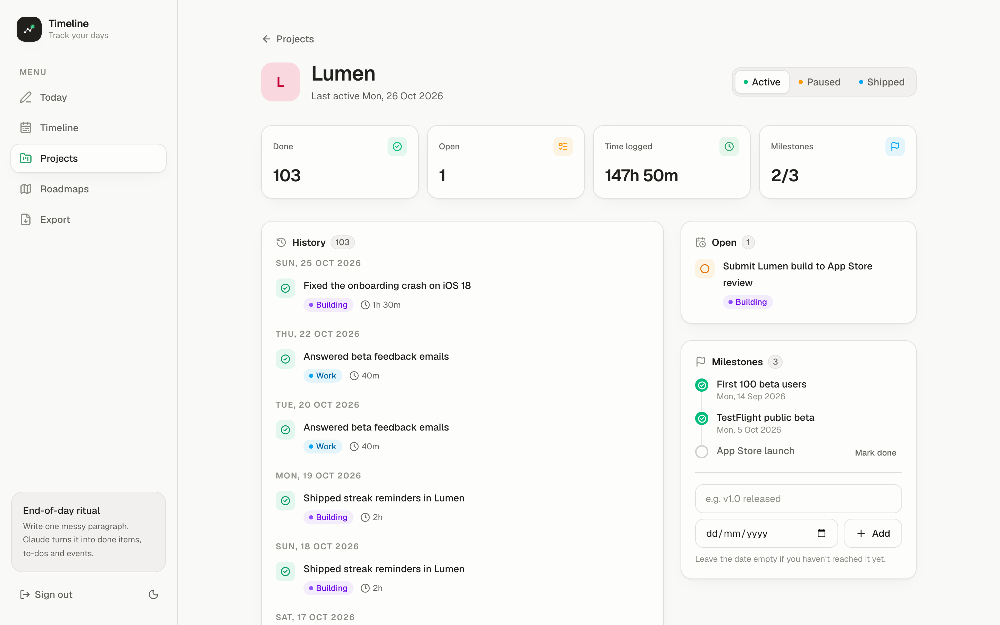

# Timeline Track

**A dev log that writes itself.** At the end of the day, type one messy paragraph about what you did. Claude splits it into **done items, to-dos and events**, tags each one with a category, project and roadmap step, and builds your timeline, project history and learning-roadmap progress from it. No boards to groom, no tickets to move.

Made for developers: side projects, open-source work, interview prep and learning plans, tracked from the way you already talk about your day.

**[Try the live demo →](https://timeline-track-inky.vercel.app/login)** Click **Try the demo** for a private sandbox with two months of sample data. It is deleted after 24 hours or when you sign out. To split logs and import roadmaps, add your own [Anthropic API key](https://console.anthropic.com/settings/keys) in the dialog. It is stored encrypted in a cookie in your browser only, never in the database.

[](https://vercel.com/new/clone?repository-url=https%3A%2F%2Fgithub.com%2Fabhinag007%2Ftimeline-track&env=DATABASE_URL,SESSION_SECRET,ANTHROPIC_API_KEY&envDescription=Neon%20connection%20string%2C%20a%20random%20session%20secret%20and%20an%20Anthropic%20API%20key&envLink=https%3A%2F%2Fgithub.com%2Fabhinag007%2Ftimeline-track%23run-it-locally&project-name=timeline-track&repository-name=timeline-track)



Built with Next.js 16, Neon Postgres, Tailwind CSS v4 and the Anthropic API (Claude Opus 5.5). Open source under the MIT License.

## Screenshots

**Review**: every item Claude proposes is editable before it's saved.

<picture>
  <source media="(prefers-color-scheme: dark)" srcset="docs/screenshots/review-dark.png">
  
</picture>

**Timeline**: a GitHub-style activity heatmap, streaks, and every logged day.

<picture>
  <source media="(prefers-color-scheme: dark)" srcset="docs/screenshots/timeline-dark.png">
  
</picture>

**Roadmaps**: paste or upload a plan; Claude turns it into phases, steps and checklists with target dates, and your daily logs tick them off.

<picture>
  <source media="(prefers-color-scheme: dark)" srcset="docs/screenshots/roadmap-dark.png">
  
</picture>

**Projects**: history, open items, time logged and milestones for each project.

<picture>
  <source media="(prefers-color-scheme: dark)" srcset="docs/screenshots/project-dark.png">
  
</picture>

## Features

- **Today**: one text box. "Split with Claude" turns your paragraph into structured items; fix any field on the review screen before saving. Open to-dos and events carry over from earlier days.
- **Smart day boundary**: anything you log before 4 AM counts as the previous day (configurable per user). You can also back-fill past days.
- **Timeline**: activity heatmap, streaks, and every day's items with 7, 30 and 90-day views.
- **Projects**: created when Claude spots a new project name (you confirm it), with status, milestones, open items and history.
- **Roadmaps**: paste or upload a long plan (.md, .txt or .pdf). Claude turns it into phases, steps and checklists with planned hours and target dates from your start date. Edit the tree, save it, and your daily logs tick steps off automatically.
- **Export**: Markdown grouped by date with a summary, filterable by category, tag and project (`/export`, or `/api/export` for scripts).
- Light and dark mode, a mobile layout with a bottom tab bar, and an installable PWA manifest.

## Run it locally

### 1. Prerequisites

- **Node.js 20.9 or newer** (`node -v`)
- A free **[Neon](https://neon.tech)** Postgres database. The app uses Neon's serverless HTTP driver, so a plain local Postgres won't work without code changes.
- An **[Anthropic API key](https://console.anthropic.com)**

### 2. Install

```bash
git clone https://github.com/abhinag007/timeline-track.git
cd timeline-track
npm install
```

### 3. Create the database

In the Neon dashboard, create a project, open **SQL Editor**, paste the contents of [`db/schema.sql`](db/schema.sql) and run it once. You can also use `psql`:

```bash
psql "$DATABASE_URL" -f db/schema.sql
```

### 4. Configure environment variables

```bash
cp .env.example .env.local
```

Fill in `.env.local`:

| Variable | Where to get it |
| --- | --- |
| `DATABASE_URL` | Neon dashboard → **Connect** → connection string |
| `SESSION_SECRET` | Any long random string, for example from `openssl rand -base64 32` |
| `ANTHROPIC_API_KEY` | [console.anthropic.com](https://console.anthropic.com) → API Keys |

`.env.local` is git-ignored. Never commit it.

### 5. Create your login

There is no public sign-up. This script asks for an email and password, adds the 9 default categories, and uses your machine's time zone:

```bash
npm run create-user
```

Anything you log before 4 AM counts as the previous day. To change the time zone or the cutoff:

```sql
update users set timezone = 'Europe/London', day_cutoff_hour = 3 where email = 'you@example.com';
```

### 6. Start

```bash
npm run dev
```

Open http://localhost:3000 and sign in. If port 3000 is taken, run `npm run dev -- -p 3200`.

## Deploy

The app needs a Node.js server (Server Actions and API routes), so it **can't run on GitHub Pages**. [Vercel](https://vercel.com) is the easiest host:

1. Click **Deploy with Vercel** at the top of this page. It copies the repo to your GitHub account and asks for the three environment variables from step 4.
2. Create the tables and your login against the same database, from your machine: run [`db/schema.sql`](db/schema.sql) (step 3) and `npm run create-user` (step 5) with the same `DATABASE_URL` in `.env.local`.
3. Sign in on your new `*.vercel.app` URL.

For faster pages, run the functions in the region closest to your database: [`vercel.json`](vercel.json) sets `sin1` (Singapore), so change it to match your Neon region. Large PDF roadmap imports can take a minute or two, which fits within Vercel's default 300-second function limit.

## Project structure

```
db/schema.sql            Database schema
scripts/create-user.mjs  Creates a login and default categories
src/app/(app)/           Pages: Today, Timeline, Projects, Roadmaps, Export
src/app/actions.ts       Server Actions (login, save log, roadmaps, …)
src/app/api/export/      Markdown export endpoint
src/lib/split.ts         Claude prompt and schema for splitting a daily log
src/lib/roadmap.ts       Claude prompt and schema for turning a plan into a roadmap
src/lib/data.ts          Database queries
src/lib/session.ts       Signed-cookie sessions (jose)
src/components/          UI components
```

## Cost

At one or two logs a day on Claude Opus 5.5, expect about $4 a month of API usage. Roadmap imports from long PDFs cost more per run.

## License

[MIT](LICENSE). You are free to use, copy, modify and distribute this project, including for commercial purposes, as long as you keep the copyright notice.

Contributions are welcome. Open an [issue](https://github.com/abhinag007/timeline-track/issues) or a pull request.
